<div align="center">


### 🚇 *Your city moves. So should you.*

Book tickets, check fares, and track your route across the metro network, all in one place.

<br/>


<br/>

**[✨ Features](#-features)** •
**[📸 Screenshots](#-screenshots)** •
**[🧱 Architecture](#-architecture)** •
**[🛠️ Tech Stack](#️-tech-stack)** •
**[🚀 Getting Started](#-getting-started)** •
**[🗺️ Roadmap](#️-roadmap)**

</div>

---

## 📖 About

**MetroGo** is a full-stack metro rail ticketing and journey assistant web application, modeled on Bengaluru's **Namma Metro** (Purple and Green Lines). It lets passengers search routes, book **QR-code e-tickets** paid through an in-app **wallet**, and manage their journeys without queueing at counters.

Beyond ticketing, MetroGo adds the things most transit apps skip: an **SOS emergency alert** system, a **Lost & Found** module, **crowd prediction**, and a gamified dashboard with **streaks, badges, and a monthly "Wrapped" recap**. Station staff get an **Admin Dashboard** to monitor bookings, revenue, emergencies, and service alerts.

> 🎓 Built as a Major Project for the **Master of Computer Applications (MCA)**, Brindavan College, Bengaluru City University (2025–2026).

---

## ✨ Features

<table>
<tr>
<td width="50%" valign="top">

### 🎫 For Passengers
- 🔐 Sign up with **OTP email verification**, JWT login, and forgot-password flow
- 🔍 **Route search** with stops, distance, time, and fare (interchange aware)
- 🎟️ **Book tickets** and get a scannable **QR e-ticket**
- 👛 **Wallet** with preset recharge amounts and full transaction history
- ❌ **Cancel tickets** with automatic refund to wallet
- 🔄 **Journey correction**: changed your exit station? The fare difference is adjusted automatically
- ⭐ **Favorite routes** for one-tap access from the home page
- 🔔 In-app **notifications** for bookings and recharges
- 💬 Floating **chatbot** for common questions (rule-based intent matching)

</td>
<td width="50%" valign="top">

### 🛡️ Safety & Network Info
- 🆘 **One-tap SOS** that instantly alerts station staff
- 📞 Quick-dial for **National Emergency 112** and the metro helpline
- 🧳 **Lost & Found** to report and browse lost items
- 👥 **Crowd prediction** by time of day
- 🗺️ **Metro map** with Purple and Green lines and interchange highlighting
- 🚆 Simulated **live train positions**
- 🚉 **Station facilities** (parking, ATM, elevator, Wi-Fi, exits, and more)
- 🧭 **Step-by-step journey guide** for every route

</td>
</tr>
<tr>
<td width="50%" valign="top">

### 🏆 Engagement
- 📊 Personal **dashboard**: trips, money spent, distance, CO₂ saved
- 🔥 **Travel streaks** (current and longest)
- 🎖️ **Achievement badges**: First Ride, Explorer, Line Master, Eco Warrior, and more
- ✨ **Monthly Recap**: a "Wrapped"-style summary with most visited station, favorite line, and busiest day

</td>
<td width="50%" valign="top">

### 🧑‍💼 For Admins
- 📈 Total **bookings, users, and revenue** at a glance
- 🛤️ **Most popular routes**
- 🚨 **Active emergency alerts** with a *Mark Resolved* action
- 📢 **Post service alerts** by line and severity
- 🔎 **Filter all bookings** by status, payment, station, date, or user

</td>
</tr>
</table>

---

## 📸 Screenshots

### 🏠 Home, Route Search & Network

<table>
<tr>
<td width="50%">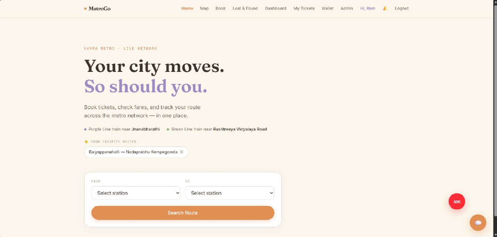<br/><sub><b>Home:</b> pick your stations and search a route</sub></td>
<td width="50%">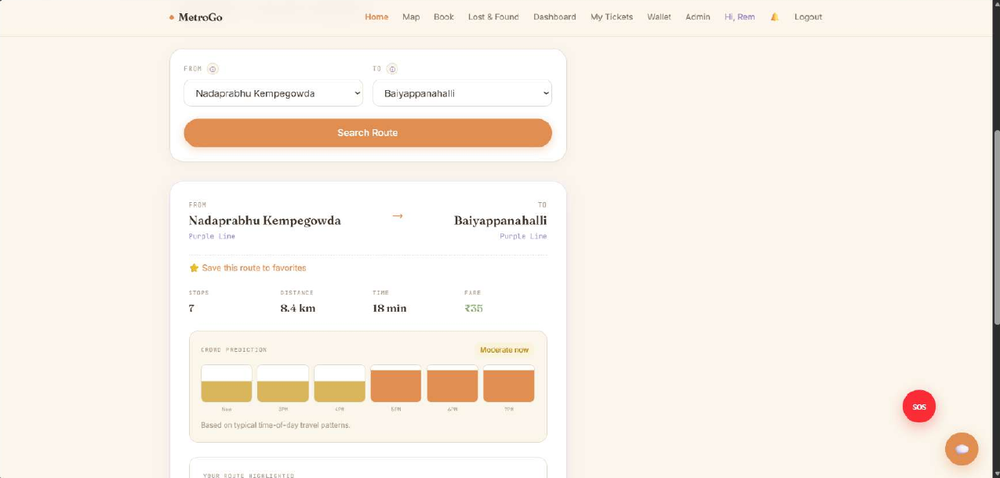<br/><sub><b>Route result</b> with fare, time, and crowd prediction</sub></td>
</tr>
<tr>
<td width="50%">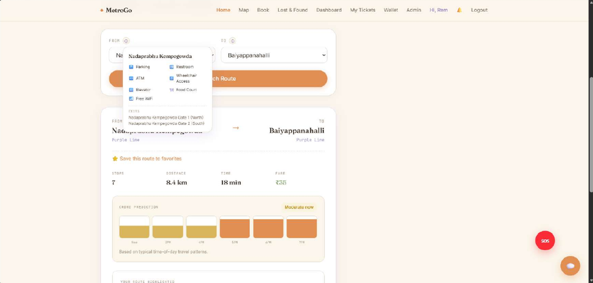<br/><sub><b>Station facilities</b> and exits</sub></td>
<td width="50%">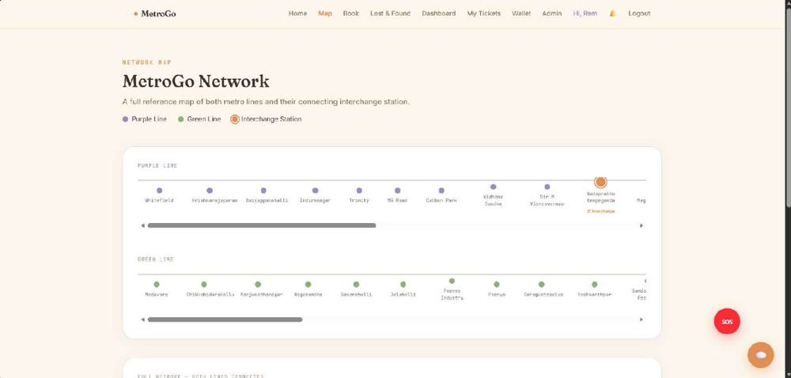<br/><sub><b>Metro map</b> with both lines and the interchange</sub></td>
</tr>
</table>

### 🎟️ Booking, Tickets & Wallet

<table>
<tr>
<td width="50%">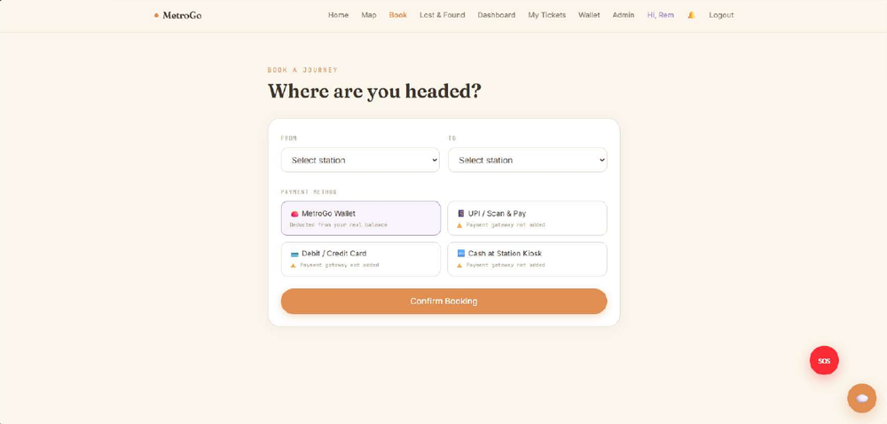<br/><sub><b>Book a journey</b> and choose a payment method</sub></td>
<td width="50%">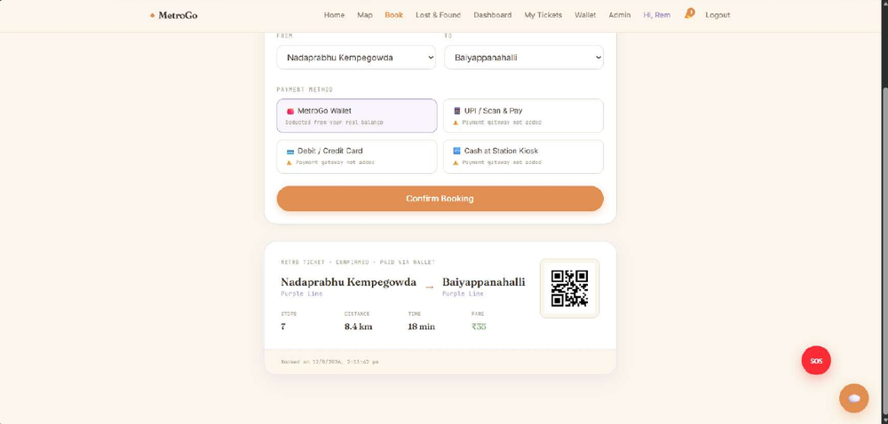<br/><sub><b>Ticket confirmed</b> and paid via wallet</sub></td>
</tr>
<tr>
<td width="50%">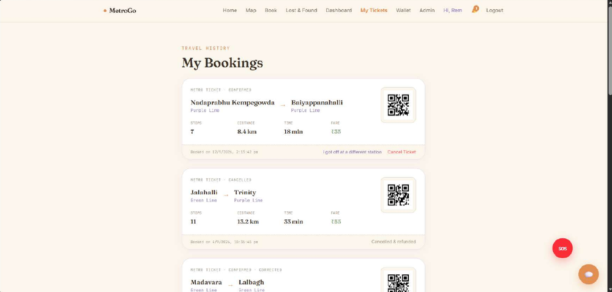<br/><sub><b>My Bookings:</b> confirmed and cancelled tickets</sub></td>
<td width="50%">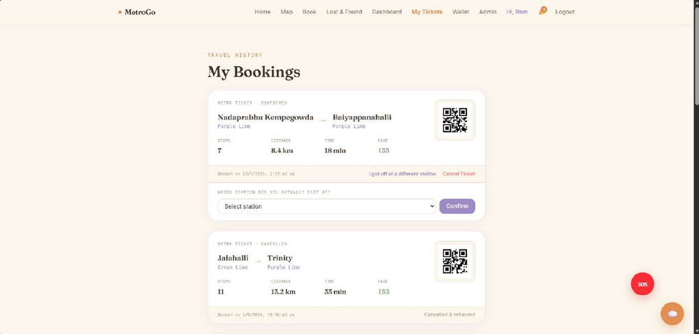<br/><sub><b>Journey correction:</b> "I got off at a different station"</sub></td>
</tr>
<tr>
<td width="50%">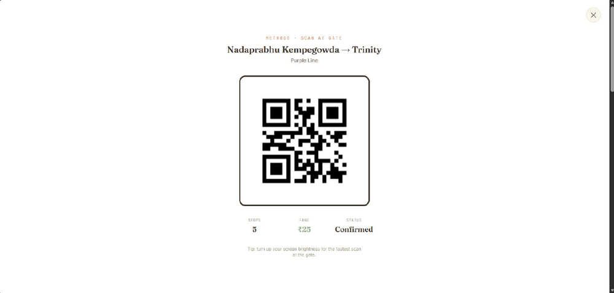<br/><sub><b>QR ticket</b> ready to scan at the gate</sub></td>
<td width="50%">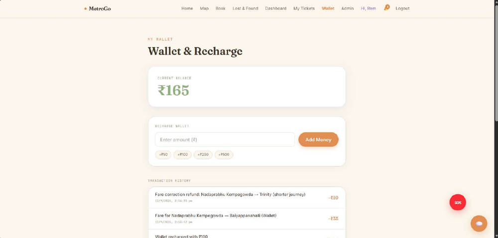<br/><sub><b>Wallet:</b> recharge and transaction history</sub></td>
</tr>
</table>

### 🏆 Dashboard, Badges & Monthly Recap

<table>
<tr>
<td width="33%">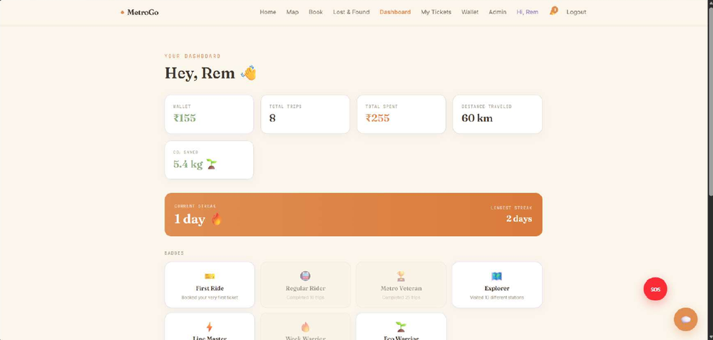<br/><sub><b>Dashboard:</b> trips, spend, distance, CO₂ saved</sub></td>
<td width="33%">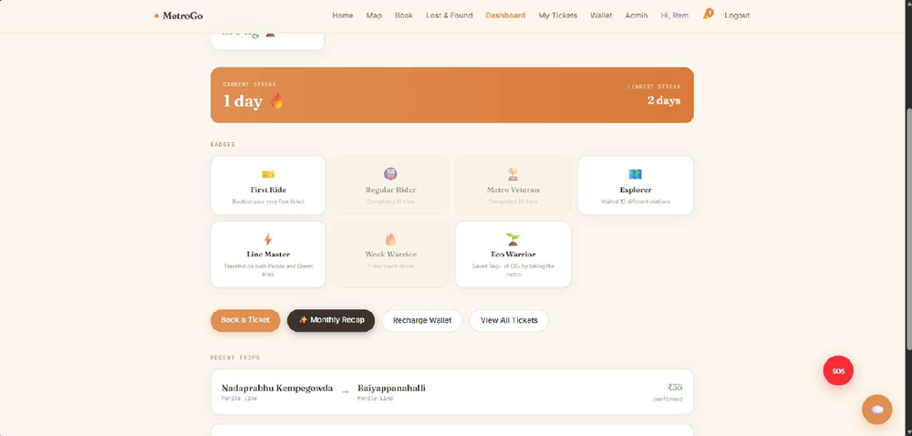<br/><sub><b>Streaks & badges</b></sub></td>
<td width="33%">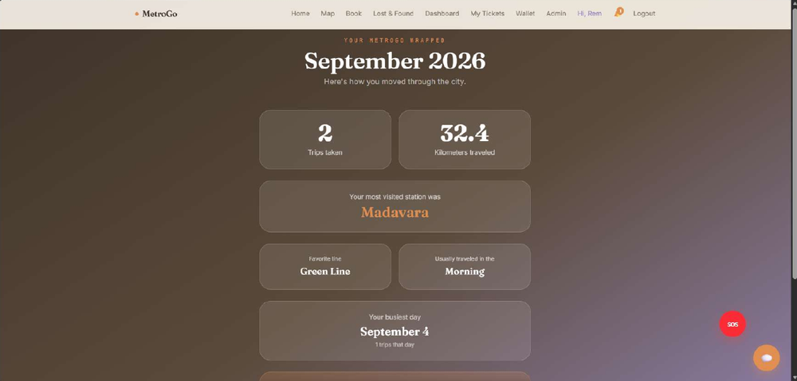<br/><sub><b>Monthly Wrapped</b> summary</sub></td>
</tr>
</table>

### 🛡️ Safety & Lost and Found

<table>
<tr>
<td width="33%">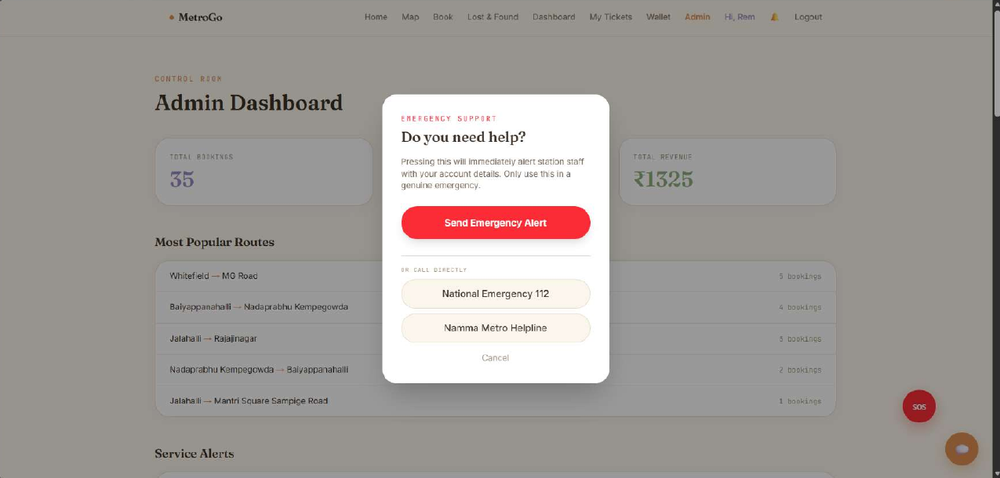<br/><sub><b>SOS:</b> alert staff or call directly</sub></td>
<td width="33%">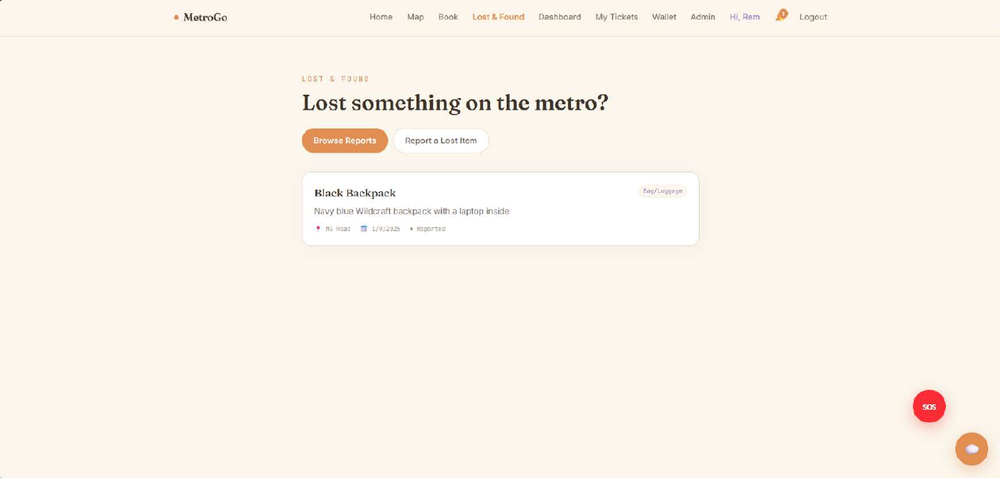<br/><sub><b>Lost & Found:</b> browse reports</sub></td>
<td width="33%">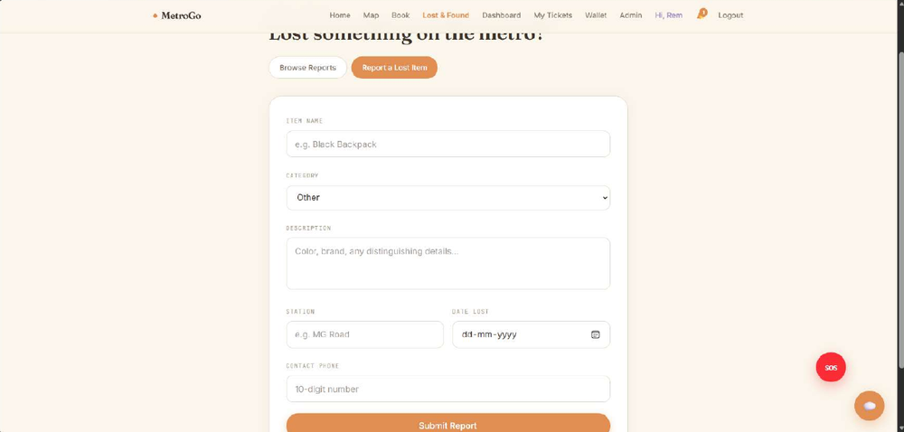<br/><sub><b>Report</b> a lost item</sub></td>
</tr>
</table>

### 🧑‍💼 Admin Control Room

<table>
<tr>
<td width="50%">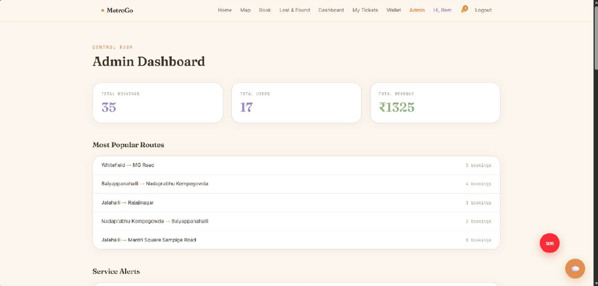<br/><sub><b>Admin Dashboard:</b> bookings, users, revenue</sub></td>
<td width="50%">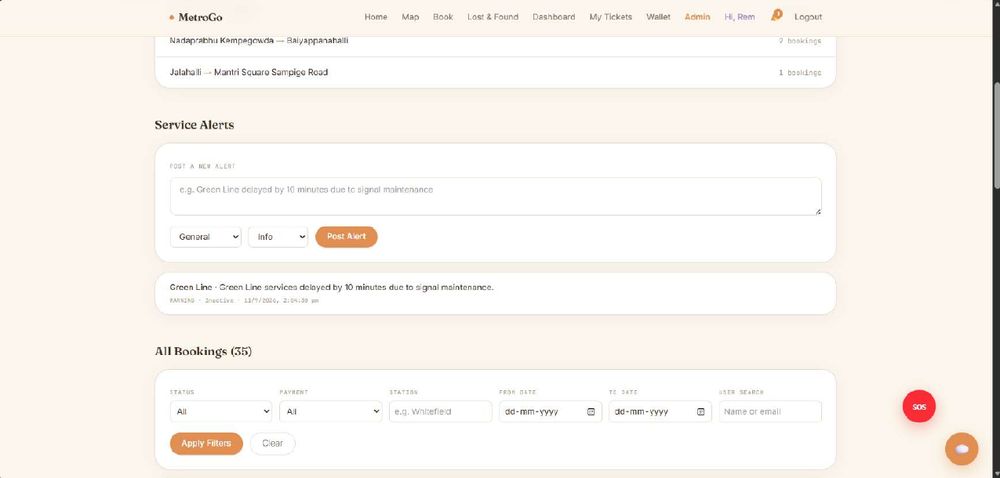<br/><sub><b>Service alerts</b> posted to passengers</sub></td>
</tr>
<tr>
<td width="50%">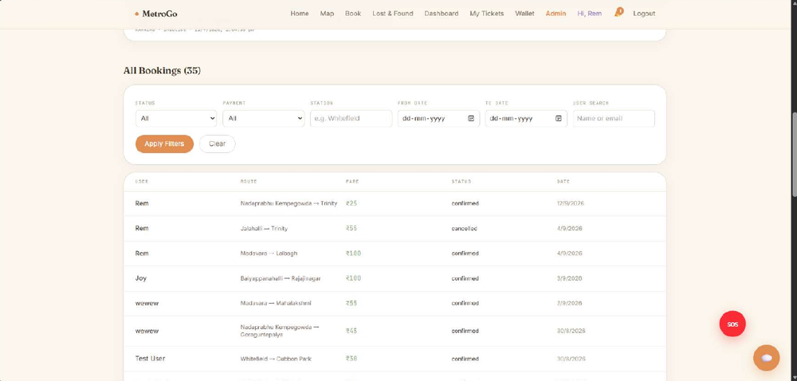<br/><sub><b>Filter</b> all bookings</sub></td>
<td width="50%">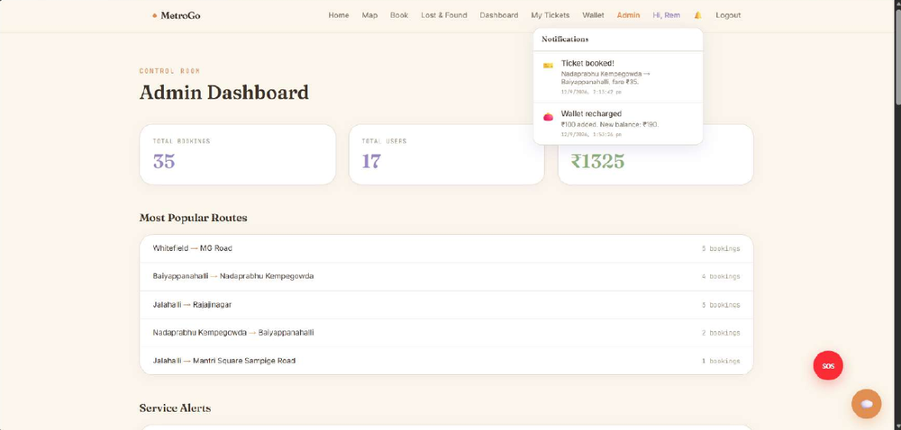<br/><sub><b>Notifications</b> bell</sub></td>
</tr>
</table>

---

## 🧱 Architecture

MetroGo follows a **three-tier client-server architecture** using the **MERN stack**, with the frontend and backend communicating over a **RESTful API**.

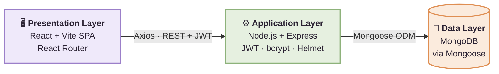

**Data collections:** `User` · `Station` · `Booking` · `Transaction` · `Notification` · `FavouriteRoute` · `EmergencyAlert` · `LostItem` · `ServiceAlert`

---

## 🛠️ Tech Stack

| Layer | Technologies |
|:------|:-------------|
| 🎨 **Frontend** | React, Vite, React Router DOM, Axios, HTML5, CSS3, JavaScript (ES6+) |
| ⚙️ **Backend** | Node.js, Express.js |
| 🗄️ **Database** | MongoDB (Atlas or Compass), Mongoose |
| 🔐 **Security** | JWT (`jsonwebtoken`), `bcryptjs`, Helmet, CORS, `express-rate-limit` |
| 🎫 **Tickets** | `qrcode` for QR e-ticket generation |
| 🧰 **Tooling** | npm, Git & GitHub, VS Code, oxlint, Postman, MongoDB Compass, dotenv |

### 🔒 Security highlights
- Passwords are **hashed with bcrypt**, never stored in plain text
- Sessions use **JWT**, and admin routes are protected by **role-based middleware**
- **Helmet**, **CORS**, and **rate limiting** guard the API
- Secrets live in a `.env` file kept out of version control

---

## 📂 Project Structure

```
metro-rail-project/
├── backend/
│   ├── controllers/     # Request handlers for each module
│   ├── data/            # Station and network data
│   ├── middleware/      # Auth and role-based access
│   ├── models/          # Mongoose schemas
│   ├── routes/          # REST API routes
│   ├── scripts/         # Helper scripts
│   ├── utils/           # Utility functions
│   ├── server.js        # Backend entry point
│   └── package.json
├── frontend/
│   ├── public/
│   ├── src/             # React pages and components
│   ├── index.html
│   ├── vite.config.js
│   └── package.json
└── README.md
```

---

## 🚀 Getting Started

### ✅ Prerequisites
- [Node.js](https://nodejs.org/) (v18 or newer recommended)
- A [MongoDB Atlas](https://www.mongodb.com/atlas) account or a local MongoDB installation
- Git

### 1️⃣ Clone the repository
```bash
git clone https://github.com/rohinip-dev/metrogo.git
cd metrogo
```

### 2️⃣ Set up the backend
```bash
cd backend
npm install
```

Create a `.env` file inside the `backend` folder with your own values:

```env
# Example only: use the variable names your server.js expects
MONGO_URI=your_mongodb_connection_string
JWT_SECRET=your_long_random_secret
PORT=5000
```

Start the server:
```bash
npm start
```

### 3️⃣ Set up the frontend
Open a **new terminal**:
```bash
cd frontend
npm install
npm run dev
```

Then open **http://localhost:5173** in your browser. 🎉

> ⚠️ **Never commit your `.env` file.** It contains secrets such as your database link and JWT key.

---

## ⚙️ Current Scope: What's Real vs. Simulated

MetroGo is an academic prototype, and its limits are stated openly:

| Feature | Status |
|:--------|:------:|
| Authentication, route search, fare calculation | ✅ Working |
| Wallet payments, QR tickets, cancellation & refunds | ✅ Working |
| Lost & Found, SOS alerts, service alerts, admin dashboard | ✅ Working |
| Gamification (streaks, badges, monthly recap) | ✅ Working |
| UPI / Card / Cash payment options | 🧩 UI placeholder |
| OTP delivery by email/SMS | 🧩 Returned in API response and logged to console |
| Live train tracking | 🧩 Schedule-based simulation |
| Chatbot | 🧩 Rule-based (not AI) |
| Testing | 🧩 Manual |

---

## 🗺️ Roadmap

- [ ] 💳 Real payment gateway (Razorpay, Stripe, or PayU)
- [ ] 📧 Production OTP delivery (Nodemailer, SendGrid, or AWS SES)
- [ ] 📡 Real-time GPS-based train tracking
- [ ] 🤖 AI/LLM-powered chatbot assistant
- [ ] 📲 Push notifications and SMS alerts
- [ ] 📱 Mobile app (React Native or Flutter)
- [ ] 🚪 QR validation at gates with a scanner app
- [ ] 📊 Admin analytics with charts and exportable reports
- [ ] 🌐 Multi-language support (Kannada, Hindi, and more)
- [ ] 🧪 Automated testing (Jest, Cypress)
- [ ] 👨‍👩‍👧 Group / family ticket booking
- [ ] 🎁 Loyalty and referral rewards
- [ ] 🔐 Two-factor authentication
- [ ] 📴 PWA with offline ticket access
- [ ] 🖼️ Image upload for Lost & Found

---

## 🤝 Contributing

Suggestions and improvements are welcome!

1. Fork the repository
2. Create a branch: `git checkout -b feature/your-feature`
3. Commit your changes: `git commit -m "Add your feature"`
4. Push the branch: `git push origin feature/your-feature`
5. Open a Pull Request

---

## 👩‍💻 Author

<div align="center">

**Rohini Pandit**
MCA, Brindavan College, Bengaluru City University

Project Guide: **Dr. Rachna Pandey**, Head of the Department, MCA

[](https://github.com/rohinip-dev)

<br/>

⭐ **If you like this project, give it a star!** ⭐


</div>
